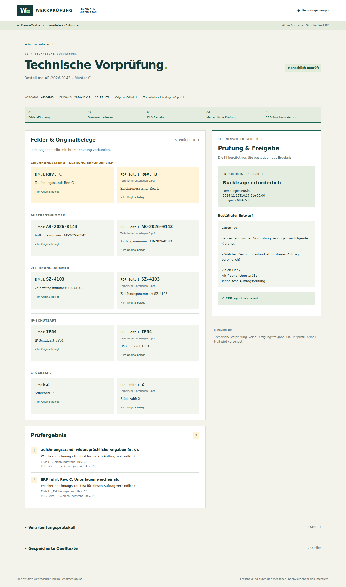
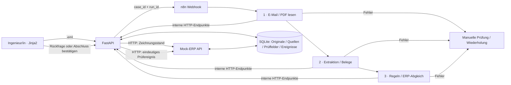

# KI-gestützte Auftragsprüfung im Schaltschrankbau

Ein lokal ausführbares Bewerbungsdemo für die Rolle **AI Process Automation Specialist** bei der Schmidbaur Unternehmensgruppe. Fiktive Aufträge, simuliertes ERP, nachvollziehbare Belege und eine explizite menschliche Entscheidung. Keine Verbindung zum Unternehmen und keine echten Kundendaten.

**E-Mail hochladen → Unterlagen lesen → Angaben mit Belegen extrahieren → Regeln und ERP prüfen → menschlich entscheiden → ERP synchronisieren.**

## Start mit Docker Compose

Voraussetzung: Docker Engine/Desktop mit Compose v2 oder neuer. Beim ersten Build werden Images und Python-Pakete heruntergeladen. Danach benötigt der Demo-Betrieb weder Internet noch API-Key.

```bash
cd schaltschrank-auftragspruefung
cp .env.example .env
docker compose up --build
```

- **Prüfoberfläche:** http://localhost:8000
- **n8n:** http://localhost:5678
- Warten, bis beide Dienste gesund sind: `docker compose ps`.
- Die Oberfläche bietet Downloads der drei `.eml`-Muster; dieselben Dateien liegen in `samples/`.
- In n8n ist der Workflow **Schaltschrank · Technische Vorprüfung** automatisch importiert und veröffentlicht. Zum Ansehen des Editors beim ersten Aufruf ein lokales Owner-Konto anlegen. Für die Verarbeitung über den Webhook ist kein Outlook-/IMAP-Konto nötig.
- Bei einem sehr frühen Upload, bevor n8n bereit ist: den gespeicherten Auftrag öffnen und **Vorprüfung erneut auslösen** wählen.

`APP_PORT` und `N8N_PORT` in `.env` ändern, falls Ports bereits belegt sind. Die Compose-Dienste kommunizieren weiterhin über ihre internen Ports. Beide Oberflächen sind an `127.0.0.1` gebunden. Das Demo hat ein festes Prüfprofil ohne Anmeldung; es ist für eine lokale Präsentation gedacht.

```bash
docker compose down        # Container stoppen; Daten bleiben erhalten
docker compose up -d       # Vorhandene Daten und Workflow weiterverwenden
docker compose logs --tail=80 app n8n
```

SQLite und Originalunterlagen liegen im Volume `app_data`; n8n-Daten einschließlich Workflow und Ausführungen in `n8n_data`. `down -v` löscht diese Daten und ist für den normalen Neustart nicht nötig. Die Workflow-Initialisierung verwendet eine feste ID und einen persistenten Prüfsummenmarker. Eine geänderte `n8n/workflow.json` wird beim nächsten Start neu importiert; dadurch werden Editor-Änderungen am Demo-Workflow überschrieben.

**Verifizierungsstand:** 26 automatisierte Tests bestanden; Docker-Start mit frischen Datenvolumes, echter HTTP-/n8n-Durchlauf für A/B/C, n8n-Neustart, ERP-Timeout und idempotente Wiederholung erfolgreich geprüft. Browser-Upload und Desktop-/Mobilansicht geprüft. Nur der echte Modellanbieter ist mangels API-Key noch nicht angebunden. Details: [docs/ABNAHME.md](docs/ABNAHME.md).



## Drei Minuten im Vorstellungsgespräch

| Zeit | Aktion | Aussage |
|---|---|---|
| 0:00–0:30 | `Auftrag-A.eml` hochladen, fünf Felder und Belege ansehen | „Wir beginnen beim tatsächlichen Arbeitsmittel: der Kunden-E-Mail.“ |
| 0:30–1:00 | **Prüfung abschließen**; menschliche Entscheidung und ERP-Ergebnis zeigen | „Die KI entscheidet nicht über den Auftrag. Die Bestätigung ist ein eigener, dokumentierter Schritt.“ |
| 1:00–1:30 | `Auftrag-B.eml` hochladen; fehlende IP-Schutzart und Entwurf zeigen | „Fehlende Angaben bleiben leer. Die Rückfrage betrifft nur das erkannte Problem.“ |
| 1:30–2:15 | `Auftrag-C.eml` hochladen | „E-Mail: Rev. C steht direkt neben PDF, Seite 1: Rev. B. Das ERP kennt C. Beide Originalbelege bleiben sichtbar.“ |
| 2:15–2:40 | Entwurf bearbeiten, **Rückfrage bestätigen** | „Der Ingenieur verantwortet die Formulierung. Es wird nichts versendet.“ |
| 2:40–3:00 | Original-E-Mail, Verarbeitungsprotokoll und n8n-Ausführung zeigen; gleiche E-Mail erneut hochladen | „Die Spur reicht vom Original bis zur eindeutigen ERP-Buchung. Duplikate öffnen denselben Vorgang.“ |

Muster A: AB-2026-0141 / SZ-4101 / Rev. A / IP54 / 2. Muster B: AB-2026-0142 / SZ-4102 / Rev. C / **IP fehlt** / 2. Muster C: AB-2026-0143 / SZ-4103 / **E-Mail C, PDF B, ERP C** / IP54 / 2. Alle PDF-Dateien sind echte einseitige Text-PDFs und zusätzlich einzeln in `samples/` enthalten.

## ERP-Timeout reproduzieren

Vor der Bestätigung eines noch ungeprüften Auftrags:

1. In der Übersicht **ERP-Fehler gezielt demonstrieren** öffnen.
2. Für **ERP-Schreibzugriff** die Option **Gespeichert, Antwort verspätet** übernehmen.
3. Auftrag öffnen und die Rückfrage oder den Abschluss bestätigen.
4. Die menschliche Entscheidung ist gespeichert. Sichtbar ist **ERP-Synchronisierung ausstehend**. Das ERP hat bereits geschrieben, aber die Antwort kam nach dem HTTP-Timeout an.
5. In der Übersicht den Schreibzugriff auf **Normalbetrieb** setzen.
6. Im Auftrag **ERP-Synchronisierung wiederholen** klicken. Danach steht dort **ERP synchronisiert**. Weitere Wiederholungen erzeugen keine weitere ERP-Zeile.

**Zeitüberschreitung** verzögert stattdessen den Beginn des Schreibzugriffs; auch hier ist ein verspäteter Commit möglich. Deshalb ist in beiden Fällen dieselbe Ereignis-ID entscheidend. Die Simulation bleibt persistent, bis sie ausdrücklich auf Normalbetrieb zurückgesetzt wird.

Für einen Lese-Timeout **ERP-Abgleich → Zeitüberschreitung** wählen, dann einen neuen Auftrag hochladen oder eine noch nicht bestätigte Vorprüfung erneut auslösen. Das Ergebnis unterscheidet **ERP-Zeitüberschreitung** von **Zeichnung im ERP nicht registriert**. Nach Wiederherstellung die Vorprüfung wiederholen. Ein technischer ERP-Ausfall erzeugt keine erfundene Kundenfrage.

## Architektur und Verantwortlichkeiten



| Arbeitsschritt | Manuell ohne Demo | Automatisiert im Demo | Verantwortung des Menschen |
|---|---|---|---|
| Eingang | E-Mail und Anhänge ablegen | SHA-256, Original und Fall-ID speichern | Richtige Unterlagen hochladen |
| Lesen | PDF und E-Mail durchsuchen | E-Mail-Text und PDF-Seiten getrennt erfassen | Scans und beschädigte Quellen klären |
| Übertragen | Angaben abschreiben | Fünf Felder als Kandidaten mit Originalzitaten | Unverifizierte Belege prüfen |
| Vergleichen | Revisionen und ERP vergleichen | Normalisierung, Pflichtfelder, Konflikte, HTTP-Abgleich | Fachliche Bewertung |
| Rückfrage | E-Mail neu formulieren | Gezielten deutschen Entwurf vorbereiten | Bearbeiten und bestätigen |
| Dokumentieren | Ergebnis ins ERP eintragen | Bestätigtes Ereignis idempotent schreiben | Synchronisationsfehler erkennen und wiederholen |

### Verarbeitung und Evidenz

- `app/parsing.py`: MIME-Parsing, Plaintext bevorzugt, HTML ohne Skripte/Styles, Text-PDF pro Seite. Maximal 12 MiB E-Mail, 5 MiB je Anhang, 30 PDF-Seiten, 150.000 Textzeichen. Scan-Seiten, verschlüsselte/beschädigte oder nicht unterstützte Anhänge führen zur manuellen Prüfung; Originale bleiben erhalten. Zu große Uploads werden vor Anlage eines Vorgangs mit einem deutschen Hinweis abgewiesen.
- `app/domain.py`: Pydantic-Schema und unabhängig testbare Regeln. Jeder Kandidat enthält Wert, Quellentyp, stabile Quellen-ID, Dateiname, Seite und wörtliches Zitat. Die App kontrolliert Quelle, Metadaten, Zitat und feldbezogene Fundstelle des Werts. Ungültige Belege werden angezeigt, gelten aber nicht als gesicherte Pflichtangabe. Der Mengenbeleg muss ausdrücklich eine Stückzahl/Menge enthalten; eine zufällige Ziffer aus einer Auftragsnummer reicht nicht.
- `app/model.py`: Demo-Antworten ausschließlich nach SHA-256 des unveränderten Originals. Auch die vorbereiteten Antworten durchlaufen dieselbe Pydantic- und Evidenzprüfung. Fremde Dateien führen zu einem klaren Hinweis auf Live-Modus oder manuelle Prüfung.
- Revisionen wie `Rev. C`, `rev c`, `Revision C` und `C` werden zu `C`. Widersprüche bleiben in allen Feldern erhalten; insbesondere werden E-Mail/PDF und ERP-Zeichnungsstand getrennt betrachtet. Bei widersprüchlichen Zeichnungsnummern wird kein willkürlicher ERP-Datensatz ausgewählt.
- Der Rückfrageentwurf ist deterministisch aus den tatsächlich erkannten Problemen aufgebaut. Dadurch kann die KI keine zusätzlichen Fragen erfinden. Ein technischer Dienstfehler allein erzeugt keinen Kundentext; ein Mensch kann bei Bedarf eine Rückfrage formulieren. Nach Bestätigung sind Entwurf und Prüfsnapshot unveränderlich.

### Idempotenz und Fehler

| Grenze | Schutz |
|---|---|
| Derselbe Upload | Eindeutiger SHA-256 in SQLite, atomare Transaktion |
| Derselbe Verarbeitungsschritt | Exklusive kurze Claim-Transaktion, eindeutiger `(case_id, run_id, step)` |
| Wiederholter/neuer Workflow | Neue Lauf-ID entwertet alte Callbacks; Ergebnisse prüfen vor Commit die aktuelle Lauf-ID und Phase |
| Menschliche Prüfung | Genau ein Prüfevent pro Auftrag, atomar mit Statuswechsel; Workflow darf danach nichts überschreiben |
| ERP-Wiederholung | Ereignis-ID als Primärschlüssel, zusätzlich ein Ergebnis pro Auftrag; abweichender Inhalt unter derselben ID wird abgelehnt |
| Gleichzeitige Synchronisierung | Eine verspätete Fehlermeldung darf einen erfolgreichen Sync nicht zurücksetzen |

Netzwerkaufrufe finden außerhalb von SQLite-Schreibtransaktionen statt. Die App speichert Schritt, Startzeit, Dauer, Ergebnis und einen bereinigten Fehlergrund. Bei einem Prozessabbruch bleibt die manuelle Wiederholung verfügbar; sie entwertet den alten Lauf. Es gibt keine automatische Fertigungsfreigabe.

Der n8n-Workflow überträgt nur Fall-/Lauf-ID und kurze Schrittergebnisse. Rohmail, PDF und vollständige Modellantwort liegen in der App-Datenbank. Die internen API- und ERP-Endpunkte verlangen `X-Internal-Token`. Normale Logs enthalten weder Dokumenttexte noch API-Key; PDF-Bibliotheksdiagnosen mit möglichen Dateifragmenten werden unterdrückt. n8n verwendet für seine App-Aufrufe ausschließlich den internen Demo-Token; der LLM-Key wird n8n nicht übergeben.

## Tests und Entwicklung ohne Docker

Python 3.11 oder neuer; die Abhängigkeiten in `requirements*.txt` sind festgeschrieben.

```bash
python3 -m venv .venv
. .venv/bin/activate
python -m pip install -r requirements-dev.txt
python -m pytest -q
python scripts/offline_acceptance.py
uvicorn app.main:app --host 127.0.0.1 --port 8000 --no-access-log
```

Der letzte Befehl startet die App. Für UI-Uploads benötigt sie auch lokal einen n8n-Webhook; ohne n8n erscheint ein gespeicherter Triggerfehler mit Wiederholungsaktion. `offline_acceptance.py` ist eine ausdrücklich gekennzeichnete Alternative zur **fachlichen Offline-Abnahme**, kein Ersatz für den n8n-Nachweis. Es nutzt echte Upload-/Review-Routen und SQLite, ersetzt aber Netzwerktransporte durch prozessinterne Adapter. Es schreibt überprüfbare HTML-Schnappschüsse nach `output/offline/` und entfernt seine temporäre Datenbank anschließend.

Die ASGI-Tests nutzen einen timerunterstützten, socketfreien Adapter: Die Sandbox der Implementierungsumgebung unterbindet die Thread-Wecksignale des üblichen synchronen Testclients. Die produktive Netzwerkimplementierung bleibt davon unberührt.

```bash
python scripts/make_samples.py   # reproduzierbare EML/PDF und vorbereitete Antworten
python scripts/make_workflow.py  # workflow.json reproduzieren
```

### Echte HTTP-/n8n-Abnahme einschließlich Neustart

Mit einem **frischen, separaten Compose-Projekt** durchführen, damit bereits bestätigte Muster nicht verändert werden. Wenn das reguläre Demo läuft, dieses vorher mit `docker compose stop` stoppen, um die Ports freizugeben.

```bash
COMPOSE_PROJECT_NAME=schaltschrank-abnahme docker compose up --build -d --wait
COMPOSE_PROJECT_NAME=schaltschrank-abnahme python scripts/smoke.py --restart-n8n
COMPOSE_PROJECT_NAME=schaltschrank-abnahme docker compose down
```

Das Skript lädt echte Muster über HTTP hoch, wartet auf n8n, prüft die Ergebnisse, Lese-Timeout plus Wiederholung, bearbeitbare Rückfragen, ERP-Schreib-Timeout nach Commit und die Duplikatfreiheit. Zwischen B und C wird n8n neu gestartet; C muss danach weiterhin automatisch verarbeitet werden. Bei erneuter Abnahme einen neuen Projektnamen verwenden. Die vorherigen Prüfereignisse werden absichtlich nicht gelöscht. Bei abweichenden Ports `--base-url` und `--n8n-url` angeben. `INTERNAL_TOKEN` wird aus der Umgebung oder `.env` gelesen und nicht ausgegeben.

## Optionaler Live-Modus

In `.env`:

```dotenv
LLM_MODE=live
LLM_BASE_URL=https://provider.example/v1
LLM_API_KEY=your-key
LLM_MODEL=your-model
```

Der Anbieter muss `POST /chat/completions` mit `response_format.type=json_schema`, strikt strukturierten Ausgaben und dem gewählten Modell unterstützen. Ein OpenAI-kompatibler Endpunkt allein garantiert diese Fähigkeit nicht. Der Schlüssel bleibt nur im App-Container. Live-Modus überträgt den extrahierten E-Mail-/PDF-Text an den gewählten Anbieter.

```bash
docker compose up -d --force-recreate app
```

Fehlende Konfiguration, HTTP-/Timeout-Fehler, ungültiges JSON oder Schemafehler führen zur manuellen Prüfung mit Wiederholungsaktion. Vollständige empfangene Modellinhalte bleiben für die Nachvollziehbarkeit in SQLite; Validierungsfehler protokollieren nur Typen, keine Inhalte. Die HTTP-Integration wird im Test mit einem Provider-Double geprüft. **Ein echter Modellanbieter wurde mangels API-Key nicht angebunden.**

## Projektstruktur

```text
app/                  FastAPI, SQLite, Parser, Modelladapter, Regeln, Services
app/templates/        Zwei deutsche Arbeitsseiten und Fehlerseite
app/static/           Responsive CSS und Status-Polling
samples/              Drei echte EML mit PDF-Anhang, PDF-Dateien, Hash-Manifest
samples/responses/    Drei vorbereitete strukturierte KI-Antworten
n8n/                  Importierbarer Workflow und Start-/Publikationsskript
scripts/              Generatoren, Offline-Abnahme und echte HTTP-Abnahme
tests/                Fachregeln, Evidenz, Konkurrenz, HTTP-Oberfläche und ERP
docs/ABNAHME.md        Tatsächlich ausgeführte Prüfungen und offene Nachweise
```

Nicht enthalten: OCR, echtes ERP, E-Mail-Versand, SSO, mehrere Rollen oder autonome Agents. Inhaltliche Fertigungsentscheidungen bleiben außerhalb dieses Demos.

n8n-Initialisierung: [offizielle CLI-Dokumentation](https://docs.n8n.io/hosting/cli-commands/) und die für das Image geprüfte [Implementierung von `publish:workflow` in 2.0.3](https://github.com/n8n-io/n8n/blob/n8n%402.0.3/packages/cli/src/commands/publish/workflow.ts). Import und Publikation erfolgen vor dem Serverstart; ein anschließender Export prüft den aktiven Zustand, bevor der Initialisierungsmarker geschrieben wird.

### n8n-2.0.3-Kompatibilität

Der gepinnte n8n-CLI-Import legt bei neuen Workflows keine für die Veröffentlichung erforderliche `workflow_history`-Zeile an. Dieser Fehler wurde beim tatsächlichen Docker-Start reproduziert. `n8n/ensure-history.cjs` ergänzt vor dem Serverstart ausschließlich für die feste Demo-Workflow-ID eine Historienversion in einer SQLite-Transaktion. Ihre ID wird aus dem Inhalt der importierten Workflow-Datei abgeleitet; erneute Starts erzeugen keine zweite Version. Anschließend erfolgen die offizielle CLI-Publikation und eine Exportprüfung. Der Start mit komplett neuen Volumes sowie der Neustart sind geprüft. Beim Upgrade von n8n diese gezielte Kompatibilitätskorrektur erneut bewerten. Die Meldung über einen fehlenden Python-Task-Runner in n8n ist für diesen ausschließlich HTTP-basierten Workflow ohne Bedeutung; die Python-Verarbeitung läuft in FastAPI.
